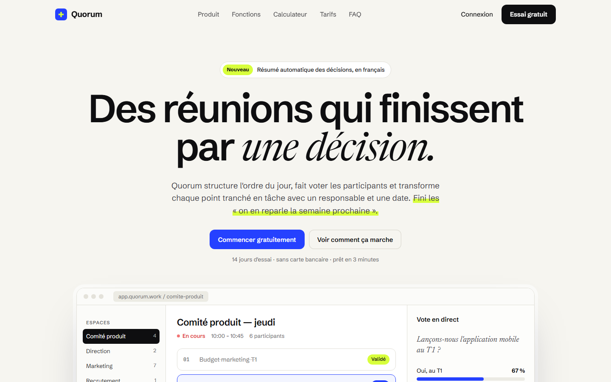
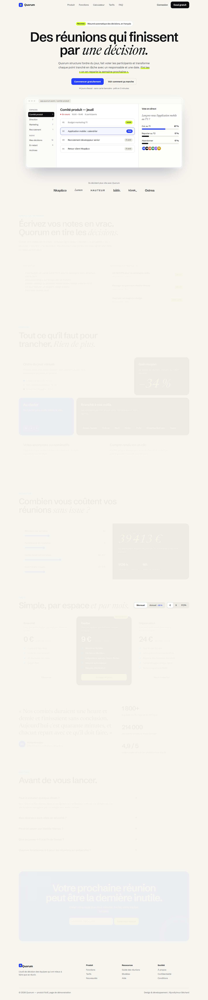
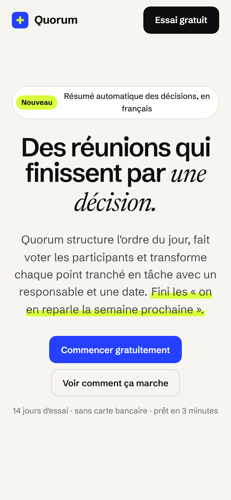

# Quorum

**Landing page · SaaS** — Page d'atterrissage d'un logiciel de prise de décision en réunion : maquette du produit animée, démo jouable, calculateur de retour sur investissement, tarifs multi-devises.

**Démo en ligne : [https://lordlennyx.github.io/quorum-saas/](https://lordlennyx.github.io/quorum-saas/)**

Spot de présentation (30 s) : [media/spot-30s.mp4](https://lordlennyx.github.io/quorum-saas/media/spot-30s.mp4)

## Ce que le projet montre

- Maquette de l'application en HTML/CSS avec vote en direct animé (aucune image)
- Démo interactive : des notes en vrac deviennent des décisions (responsable, échéance)
- Calculateur d'économies piloté par curseurs
- Tarifs mensuel / annuel en euros, dollars ou francs CFA
- FAQ en accordéon, formulaire d'inscription validé, entièrement responsive

## Réalisation

- **Stack :** HTML, CSS, JavaScript natif
- **Typographies :** Schibsted Grotesk, Newsreader, JetBrains Mono
- **Rédaction :** textes de conversion écrits pour le produit

| Bureau | Mobile |
|---|---|
|  |  |

---

Client et contenus fictifs, créés pour la démonstration. Conception, design et développement : **Njundiyimun Béchard** — [github.com/LordLennyx](https://github.com/LordLennyx)
